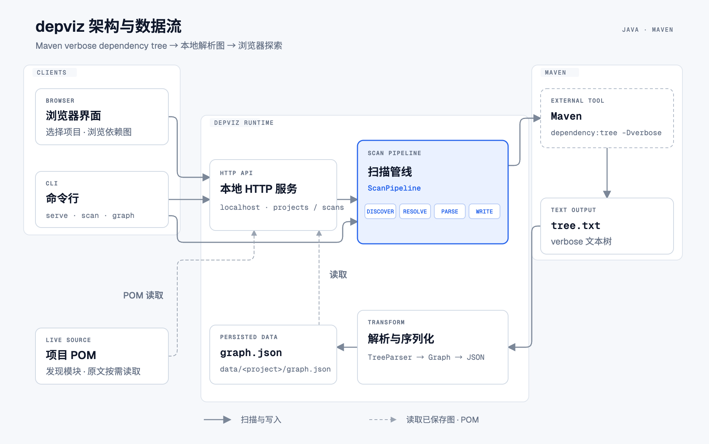

<p align="center">
  
</p>

<h1 align="center">depviz</h1>

<p align="center"><strong>把 Maven 依赖树变成可以点开的依赖图</strong></p>

<p align="center">
  
  
  
</p>

depviz 是一个本地运行的 Maven 依赖分析工具。选择一个 Maven 项目目录，它会执行 `mvn dependency:tree -Dverbose`，把整棵依赖树解析成可交互的依赖图，帮助回答几个日常开发里最常见的问题：

- 这个依赖是从哪条路径被拉进来的？
- 同一个依赖为什么出现了多个版本，最终哪个版本生效？
- 某个模块里声明的依赖，为什么没有出现在构建结果里？

扫描过程只读：不会构建或修改目标工程，所有数据都保存在本机。

## 功能

- **依赖路径**：选中任意依赖，列出从各模块根到它的全部引入路径，并按深度排序。
- **版本冲突**：并列展示重复声明、被版本仲裁取代的依赖，以及最终生效的版本。
- **多模块工程**：选择子模块时自动定位 reactor 根并扫描整个项目，可按模块查看各自的依赖结论。
- **按需渲染**：依赖图不会一次性铺满画布，选中依赖后才渲染相关子图，大项目也能流畅浏览。
- **结果复用**：扫描结果保存在 `data/<项目名>/graph.json`，重启服务后直接打开，无需重新执行 Maven。
- **零运行时依赖**：HTTP 服务与 JSON 处理均基于 JDK 实现，一个可执行 JAR 即可运行。

## 架构



从项目发现、Maven 扫描、依赖树解析到浏览器渲染的完整数据流。

## 快速开始

### 环境要求

| 组件 | 要求 |
| --- | --- |
| JDK | 8 或更高版本 |
| Maven | 3.2.5 或更高版本 |

### 从源码运行

```bash
mvn -B -o -q -DskipTests package
java -jar target/depviz.jar
```

浏览器会自动打开 `http://127.0.0.1:8080`。如果端口被占用，服务会向后寻找可用端口，并在终端打印实际地址。

### 使用发行包

```bash
unzip depviz-*.zip -d depviz
cd depviz
./depviz.sh start
```

`./depviz.sh status` 查看运行状态，`./depviz.sh logs` 查看日志，`./depviz.sh stop` 停止服务；调试时使用 `./depviz.sh foreground` 前台运行。`DEPVIZ_HOME` 可指定配置、数据与日志的存放目录。

## 使用方式

1. **选择项目**：首页可以用内置目录浏览器逐层选择，也可以直接粘贴路径，或通过 `?project=/path/to/project` 打开。
2. **开始分析**：首次打开会执行一次 Maven 扫描。扫描完成后，结果保存到 `data/<项目名>/graph.json`，之后从「最近打开」进入即可，不会重跑 Maven。
3. **阅读依赖图**：顶部搜索框按 `groupId:artifactId` 搜索；左栏展示所选依赖的全部路径与版本冲突；右栏展示模块信息、POM 原文和声明依赖。

界面还提供「只看生效」「隐藏 test / provided」和模块筛选等开关，具体说明见 [USAGE.md](USAGE.md)。

## 命令行

除了 Web 界面，depviz 还提供三个命令行子命令：

| 命令 | 作用 |
| --- | --- |
| `serve` | 启动本地 Web 服务 |
| `scan` | 执行一次 Maven 扫描并生成图数据 |
| `graph` | 解析已有依赖树，或为已有 JSON 输出统计信息 |

```bash
java -jar depviz.jar serve [--port 9000] [--no-browser]
java -jar depviz.jar scan <project-dir> [-o graph.json] [--offline|--online]
java -jar depviz.jar graph <project-dir> [--tree tree.txt] [-o graph.json]
java -jar depviz.jar graph graph.json --stats
```

## 扫描说明

- depviz 使用 `mvn dependency:tree -Dverbose` 的文本输出。Maven 依赖插件的 JSON 输出会遗漏被省略的依赖记录。
- Maven 插件会向报告文件追加内容，因此每次扫描使用独立的输出文件，避免旧结果混入。
- 默认在线运行。启用离线模式后，如果 Maven 返回可通过联网解决的依赖解析错误，depviz 会自动在线重试一次。
- 扫描图保存在 `data/<project>/graph.json`，可在后续启动时重新打开。POM 原文按需从项目目录读取，不随图数据保存。

## 项目结构

```
src/
├── main/java/cn/dmego/dev/depviz/
│   ├── cli/         命令行入口
│   ├── config/      配置加载与保存
│   ├── desktop/     浏览器启动
│   ├── discover/    Maven 项目与模块发现
│   ├── env/         Java / Maven 环境探测
│   ├── http/        本地 HTTP 服务、扫描任务与图数据存储
│   ├── json/        JSON 输出
│   ├── log/         日志
│   ├── model/       依赖图模型
│   ├── parse/       依赖树解析
│   └── scan/        Maven 扫描流程
├── main/resources/static/   前端页面与静态资源
└── test/                    单元测试与测试数据
tools/                       构建校验与端到端脚本
docs/                        架构图与项目 Logo
```

## 开发

```bash
mvn -B -o test        # 单元测试
sh tools/verify.sh    # 构建、单元测试与端到端校验
./build.sh --test     # 构建发行包并运行测试
```

`tools/verify.sh` 中的浏览器检查需要 Python Playwright 与 Chrome。

## 贡献

欢迎提交 Issue 和 Pull Request。提交前请确认 `mvn -B -o test` 通过；涉及扫描、解析或前端行为的改动，建议再运行一次 `sh tools/verify.sh`。

更详细的界面操作、设置项与排障说明见 [USAGE.md](USAGE.md)。
